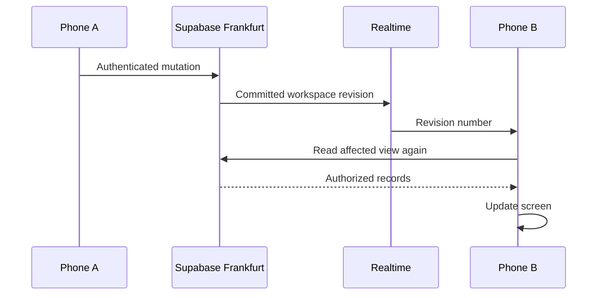

# Folio performance case study — 13 November 2026

## Decision

Keep Next.js, Supabase and TanStack Query. The main opportunity is to shorten the data path and reduce redundant work, rather than add another general state library or rewrite the dashboard. Prioritize function/database region alignment, narrower invalidation, parallel authenticated reads, and record-level reconciliation. Consider a local-first sync engine only if offline operation and locally queryable collections become product requirements.

This audit distinguishes confirmed code/infrastructure findings, earlier live measurements, and hypotheses requiring instrumentation. The footer removal and search-specific skeleton are the only product changes in this audit release. Infrastructure migration and a new synchronization architecture have not been silently applied.

## Evidence and limits

Inspected the deployed repository, query/cache hooks, auth, route layouts, workflow actions, selection deletion, database functions and realtime transport. Supabase project metadata returned database region `eu-central-1` (Frankfurt). Existing Vercel deployment inspections identify function execution in `iad1` (Washington). This is an infrastructure mismatch; its precise contribution in milliseconds has not been isolated.

The retained earlier production report, `tests/search-realtime-remote.mjs` / `.local-test-output/search-realtime-report.json`, recorded these observations in two independent authenticated Chromium contexts, one with a mobile viewport:

| Operation | Observed end-to-end time |
|---|---:|
| SDK status write to second-browser visibility, Interested | 1,250 ms |
| SDK status write to second-browser visibility, New | 1,257 ms |
| Search form Save to second-browser visibility | 1,414 ms |
| Confirm delete to second-browser disappearance | 1,431 ms |

These are earlier fixture observations, not fresh measurements of this audit release, physical-phone measurements, a p95, or pure websocket delivery times. They include write/network/refetch/render work. Your reported approximately two seconds on another phone is plausible but has not been independently reproduced on those physical devices.

### Fresh completed profiling run

After access was restored, `tests/performance-audit-remote.mjs` completed successfully against production using two independent headless Edge/Chromium contexts, including a 390px mobile viewport. The run used a disposable owner, initial three-record import, single-record deletion, then an additional 1,000 synthetic records. The account and records were removed afterward. Sanitized raw output: `docs/performance-audit-data-2026-11-13.json` (original local output: `.local-test-output/performance-audit.json`).

| Status write | HTTP write response | Revision received on other browser | Updated row visible there |
|---|---:|---:|---:|
| Interested | 641 ms | 922 ms | 1,498 ms |
| New | 351 ms | 808 ms | 1,156 ms |
| Interested | 392 ms | 494 ms | 1,239 ms |
| New | 220 ms | 667 ms | 1,068 ms |

All three timestamps are relative to starting the mutation, not durations to add together. Median total visibility was approximately 1,198ms. Median interval from websocket receipt to visible updated data was approximately 489ms: this confirms a material post-event reread/render cost. Browser automation observation contributes to the visible-time metric; it is not a physical display-paint trace. Confirmed UI deletion to second-browser disappearance measured 1,666ms in this run.

Client Link navigation to a visible heading measured 1,526ms for Overview, 1,105ms for Attempts, and 993ms returning to the collection. These are one sample each; they do not establish a p95. Hard navigations measured 40,336ms on initial country entry, 9,279ms on the next collection entry, and 1,869–2,356ms on later entries. The 40-second observation is a severe isolated outlier, not a claim that every navigation takes 40 seconds. The same run captured a 17,116ms Server Action response and a 10,219ms direct workspace revision read. That mixed-path stall means network/service cold behavior must be traced; attributing it solely to Vercel compute, region distance, or SQL would be unsupported.

Direct authenticated RPC response samples (including network, not pure SQL):

| Read | Samples | Median |
|---|---|---:|
| Lead list, 2 surviving records | 248, 218, 235ms | 235ms |
| Workspace state, 2 surviving records | 224, 245, 222ms | 224ms |
| Lead list, 1,002 surviving records | 321, 353, 331ms | 331ms |
| Workspace state, 1,002 surviving records | 666, 234, 228ms | 234ms |

The lead list still returns at most 15 rows. This small scale experiment does not demonstrate a multi-second SQL bottleneck at 1,002 records. It also does not validate 10k/50k owners or simultaneous imports. The scale import itself was outside these read timings.

Across the complete multi-route/multi-mutation run, the browser traces captured 48 relevant responses: 16 lead-list RPC responses, 13 revision reads, 18 dashboard-route POST responses, and one UI mutation RPC response. This is aggregate run activity, not 48 requests per mutation. The mobile search document observed 18 JS resources totaling approximately 1.10MB decoded and 344KB transferred; no main-thread profile establishes that JS is the dominant cause.

A metadata SQL query confirmed the `pg_stat_statements` extension schema, but the subsequent aggregate-statistics query again returned 403. No production SQL execution plan, lock wait distribution, or pg_stat_statements timing is claimed. Earlier attempts also had one corrected missing scale-import argument and a browser network-suspension failure; only the completed run above supplies fresh measurements. These limitations remain important despite the successful browser run.

## 1. Cross-region server reads — confirmed, high priority

Server Action reads currently follow browser → Vercel Washington → Supabase Frankfurt → Vercel → browser. Calls through `databaseContext()` also perform auth-server user verification through `getUser()`. That can introduce a separate remote call before the database request. Request-local React `cache()` already deduplicates verification within a render; it is not a cross-request session/data cache.

A hard dashboard entry waits for `requireUser()` and `fetchWorkspaceState()` before the provider/shell is ready. Shared layouts are generally reused on client transitions, so this must not be described as a full layout reload on every click. However, client-invoked Server Action reads still repeat their authenticated server path.

**Action:** deploy authenticated data functions near the existing database, using Frankfurt as the first candidate, and compare identical traces before/after. Preserve an easy region rollback. Do not move the database merely to guess a faster region for Pakistan; that is a separate migration decision. Direct browser-to-Supabase RPCs bypass Vercel, so region alignment will not accelerate every operation equally.

[Vercel function-region guidance](https://vercel.com/docs/functions/configuring-functions/region) recommends locating functions close to the data source.

## 2. Broad invalidation amplifies each change — confirmed, high priority

`Providers.refreshPages()` calls `invalidateQueries({queryKey:[ownerId]})` and reloads workspace counts. Every mounted active query under the owner is eligible for refetch: lead lists, header call analytics, country structure, workflow panels and preferences. Cached inactive queries become stale; they are not all immediately fetched. A simple status change therefore causes unrelated work across both devices.

**Action:** attach a change domain and affected IDs to the revision protocol, e.g. lead ID, collection ID and operation type. Refresh only affected collections, counters and views. Lead edits should not reload country names or import preferences. Coalesce noncritical count/analytics refreshes behind record updates. Preserve privacy revision handling, owner separation, reconnect catch-up and missed-message reconciliation.

[TanStack Query invalidation](https://tanstack.com/query/latest/docs/framework/react/guides/query-invalidation) supports targeted cache invalidation; this is already the installed cache layer, not a missing dependency.

## 3. Realtime currently signals changes rather than delivering screen state — confirmed, high priority

Only `workspace_sync` is published. This intentionally avoids distributing business records/deleted-row payloads and coalesces an import transaction into a revision signal. On a remote change, the browser waits for that signal, then requests authorized data, then renders it.

The relevant budget is write transit + transaction + event delivery + reread transit/query + render. Adding up HTTP timings naively can be wrong because a websocket event can arrive before the writer receives its HTTP response.

The controller batches for 25 ms, not two seconds. Its 15-second revision polling is recovery, not the normal live path. Reducing either timer to an extreme is not the main fix.

**Action, incremental:** send an authorized affected-record identifier, fetch that record rather than a whole enriched list, and patch cache entries. Reconcile membership when status, deletion, filters or pagination change. Delete events must not expose deleted lead details. Consider returning the canonical saved record with the mutation response to avoid a writer-side reread.

**Action, architectural:** evaluate private database-triggered Supabase Broadcast for scoped change events. Supabase recommends Broadcast for scalability, but changing transport alone does not prove subsecond latency; retaining the same full reread would retain much of the cost. Private-channel authorization, transaction commitment, monotonic revisions, deduplication, reconnect and import coalescing are mandatory. Avoid unauthenticated public channels and broadcasting full private rows.

[Supabase database-change subscriptions](https://supabase.com/docs/guides/realtime/subscribing-to-database-changes), [Postgres Changes limitations](https://supabase.com/docs/guides/realtime/postgres-changes).

## 4. Server Actions remain on read-heavy paths — confirmed, high priority

Direct authenticated reads/writes were already introduced for ordinary lead lists, lead saves and detail reloads. Other areas still use the generic `useQuery()` loader with Server Actions: WhatsApp, countries, analytics, workspace counts, settings and portions of workflow/history. Calling these concurrently from components does not guarantee parallel dispatch through the Server Action client queue.

**Action:** migrate independent reads to direct RLS-protected Supabase queries/RPCs where suitable, or authenticated GET Route Handlers with cancellation. Server Components should access their data source directly. Keep Server Actions for appropriate mutations/orchestration. Do not copy service-role credentials into browser code, trust unverified cookie payloads, or shared-cache private data to gain speed.

[Next.js mutation guidance](https://nextjs.org/docs/app/getting-started/mutating-data) documents the current one-at-a-time client dispatch behavior. Implementing a different read transport matters more than merely wrapping existing calls in `Promise.all` in the browser.

## 5. Unopened settings fetch and refetch — confirmed, small but wasteful

`ApplicationSettings` remains mounted in the shell and calls `useQuery(application-settings:${open}, importPreferences)` even when closed. The generic hook is enabled whenever the workspace can fetch. Toggling open also changes its cache key, so closed/open variants can both be cached. Broad invalidation can refetch a mounted preferences query after unrelated lead updates.

**Action:** enable this read only while settings is open; use one stable preferences key. Defer loading the settings/import UI code until needed. Validate this with the network panel: zero preference reads before opening settings, one cached/deduplicated read when opened, no preference read after a lead-status edit.

## 6. Navigation has both transport and presentation costs — confirmed design; magnitude unmeasured

Authenticated routes are dynamic. The dashboard has a generic loading boundary; search previously inherited a dashboard-shaped skeleton and did not have a specialized query-results skeleton. Header search uses `router.push`, which does not gain a visible Link's automatic viewport prefetch by itself. Sidebar Links already provide Next.js navigation behavior; this is not an absence of client routing.

**Applied now:** removed the screenshot footer, added a search-route loading boundary, and added matching search-result placeholders. This improves feedback and layout consistency; it does not make the database faster.

**Next:** use a semantic Link or focused hover/focus prefetch for header search and common destinations. Retain mounted cached lists and prior results while refreshing where appropriate. Separate shell-ready, heading-visible and data-ready timing. Avoid prefetching every private route unconditionally: that can multiply expensive reads and worsen the same server queue.

[Next.js navigation/loading guidance](https://nextjs.org/docs/app/getting-started/linking-and-navigating).

## 7. Deletion must be audited by path — confirmed

Single-lead deletion uses an authenticated direct RPC and publishes a local optimistic removal. It already avoids the old server-read queue for the write. Its second-device delay still includes the revision/reread chain.

Selected deletion is different: `SelectionDelete` may preview missing selected rows, calls the Server Action `deleteLeadSelection`, waits for success, and then calls `onChanged`. Preview queries use sequential batches of 75 IDs when needed. The transactional delete preserves expected timestamps, idempotency, history and undo. These are important correctness features, not work to casually remove.

**Action:** distinguish confirmation-click → local row disappearance, confirmed transaction, and other-device disappearance. Use a TanStack Query mutation with explicit pending/optimistic selected-row removal and rollback. Do not label a timeout as successful deletion. Preserve the existing uncertainty/idempotency handling. Consider returning confirmed row IDs/revision and using the direct guarded RPC after measuring the Server Action overhead.

[TanStack optimistic-update guidance](https://tanstack.com/query/latest/docs/framework/react/guides/optimistic-updates).

## 8. SQL enrichment and owner-wide locks are scaling candidates — not proven primary bottlenecks

`workspace_leads` computes counts and summaries, joins attempts/followups, obtains latest notes and suppression state, and performs substring/normalized-phone matching. Several references to the filtered result can cause substantial work before the final 15-row output. `workspace_pages()` aggregates across collections on each counts refresh. Phone normalization is computed in search expressions. None of this is automatically slow at today's data size, and no production EXPLAIN result was available. The direct-RPC scale samples above do not suggest multi-second query execution at 1,002 records.

Several workflow paths take an owner-scoped advisory transaction lock. It prevents unsafe concurrent operations, but can serialize writes for one owner during imports or other long transactions. Actual lock-wait time is not measured here. Do not replace it with per-lead locks without reviewing cross-page Maps uniqueness and transactional invariants.

**Action:** inspect `pg_stat_statements`, query plans with `EXPLAIN (ANALYZE, BUFFERS)`, actual lock waits and representative 1k/10k/50k owners. Enrich only the paginated rows if plans show full-set enrichment. Evaluate normalized phone columns plus trigram indexes for substring search, matching the exact expression/predicate. Regular B-tree indexes do not generally solve leading-wildcard substring queries; short search terms can remain broad even with trigrams. Maintain historical counters carefully if considering incremental summaries.

[Supabase database inspection](https://supabase.com/docs/reference/cli/supabase-inspect-db-seq-scans), [PostgreSQL pg_trgm](https://www.postgresql.org/docs/17/pgtrgm.html).

## 9. JavaScript and low-end phone rendering need evidence

The shell statically imports settings; collection screens statically import CSV and detail/calling dialogs. This can increase initial route work even when those dialogs stay closed. React Query currently keeps cached data for two minutes and treats it as fresh for 30 seconds; these are cache freshness/lifetime choices, not two-second render timers.

**Action:** measure route-specific downloaded/decoded JS, long tasks, LCP, INP and layout shifts on actual Android/iOS devices. Use built-in lazy loading for heavy optional dialogs, preserve touch responsiveness and size placeholders correctly. Do not declare JavaScript the dominant bottleneck without a browser trace. The tables currently display 15 rows, so virtualization is lower priority than network/dataflow work.

## Tools and libraries suited to this app

| Tool | Decision | What it addresses | What it does not solve |
|---|---|---|---|
| TanStack Query (already installed) | Keep; use scoped keys, `useMutation`, rollback and cache patches consistently | Request deduplication, optimistic feedback, selective refresh | Physical network latency or event delivery |
| Supabase JS + private Broadcast | Evaluate incremental adoption | Scoped authenticated change delivery | Does not remove full rereads unless the cache/data protocol changes |
| Next.js Link, Suspense/loading, dynamic import | Use built-ins | Navigation feedback, selective prefetch, optional bundle loading | Slow SQL/server geography |
| `web-vitals` + sampled marks; optionally Sentry or OpenTelemetry | Instrument before the next optimization wave | Real-user interaction metrics and trace attribution | They observe latency; they do not remove it |
| PostgreSQL `pg_stat_statements`, EXPLAIN, optional `pg_trgm` | Profile first; index measured predicates | Query costs, scans, lock/index diagnosis | Browser cache invalidation or transatlantic requests |
| TanStack Virtual | Defer while lists remain 15 rows | Very long rendered lists | Current sync/read round trips |
| TanStack DB | Optional prototype if relational client collections become useful | Live client queries and optimistic collection operations | Still needs a persistence/sync strategy; not a drop-in latency cure |
| PowerSync | Consider only for an offline/local-first requirement | Local SQLite reads, queued writes and synchronization | Other-device commitment still needs the network; adds schema, auth, storage, conflict and operational design |

[TanStack Virtual](https://tanstack.com/virtual/latest/docs/introduction?from=reactVirtualV2), [TanStack DB](https://tanstack.com/db/latest/docs/guides/mutations), [PowerSync's architecture](https://powersync.com/sync-postgres), [web-vitals](https://web.dev/articles/vitals?hl=en). These are options matched to actual problems, not a recommendation to install every package. Adding Redux, Zustand, SWR alongside the existing query cache, Socket.IO alongside Supabase, or Redis without a measured server-cache need would add systems without removing the identified waits.

## Ordered implementation plan and acceptance criteria

1. **Instrument and align region.** Record request/operation IDs, mutation response, websocket arrival and second-device paint on a shared monotonic clock per browser. Compare same database/user/fixture from the same two devices with `iad1` versus a Frankfurt candidate. Keep function region change separate for rollback.
2. **Stop unnecessary reads.** Gate settings; invalidate by domain; defer counts/analytics; move independent read-heavy workflows off queued action dispatch. Verify request counts per mutation before/after.
3. **Return and reconcile affected records.** Canonical mutation result → writer cache; committed authorized event → receiver patch/focused fetch; background count refresh. Test status-dependent membership, delete, undo, pagination and overlapping edits.
4. **Optimize SQL from evidence.** Capture plans/lock waits and load-test representative owners. Preserve audit, permissions, suppression, uniqueness, idempotency and retry safety.
5. **Reduce navigation/render work.** Add focused prefetch and lazy optional dialogs; evaluate physical low-end phones. Only then consider a local-first prototype if product needs justify it.

Suggested engineering targets, not achieved guarantees: local pending feedback within 100ms; warm cached navigation feedback within 100–200ms; p75 INP at or below 200ms; connected second-device committed-record visibility below 500ms median and below 1s p95 as an investigation goal after the dataflow change. Revisit the cross-device target against actual network distance and results; no library can promise instantaneous receipt on another disconnected or sleeping phone.

Acceptance runs should cover at least 30–100 operations per path across separate real devices, warm and cold entry, normal/mobile network conditions, status/delete/bulk undo, reconnect, rejected stale writes, import contention and cross-owner isolation. Report p50/p95 and failed samples rather than just the fastest successful run. Keep lead names, phone numbers, tokens and note content out of telemetry. Background-tab throttling and offline devices must be reported separately from foreground connected latency.

## Recommendation

The immediate work is a focused performance pass on the existing stack: function-region alignment, scoped invalidation, parallel read transport and authenticated record-level reconciliation. Optimistic updates make the initiating device feel immediate; an improved committed-event protocol plus fewer reads makes the second device faster. A platform rewrite is not justified by the evidence collected here.
